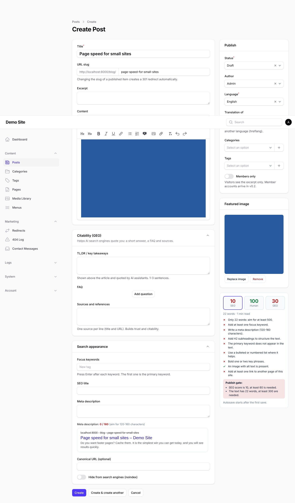

# larawebkit

An open-source (MIT), AI-ready Laravel starter kit for websites and web apps.

Start every project with the boring parts already done — admins and roles with 2FA, pages and posts,
a content editor with live SEO / human-ness / GEO scores, a WordPress-style media library with an
all-WebP image pipeline, stock photos, an AI writing assistant, audit/access/auth logs, three themes,
complete SEO and AI-search (GEO) support and cookie consent — plus a codebase your AI coding agent can
extend safely, guided by [`CLAUDE.md`](CLAUDE.md) / [`AGENTS.md`](AGENTS.md) and step-by-step [recipes](docs/recipes).

> **Status: v0.1.** See [docs/plan.md](docs/plan.md) for the scope and [CHANGELOG.md](CHANGELOG.md).



**Stack:** PHP 8.3+, Laravel 13, Filament 5 (admin), Livewire 4, Pest 4, Blade + Tailwind 4 (Vite).
SQLite locally, MySQL/MariaDB in production. Runs on plain shared hosting (cPanel): no Redis, no Node in production.

## Quick start

```bash
git clone https://github.com/<you>/larawebkit.git my-site && cd my-site
composer setup            # install, .env, key, migrate, seed, storage link, build assets
php artisan larawebkit:install   # site name, language, first admin (super-admin)
php artisan larawebkit:demo business   # optional: demo site (business, personal, magazine, docs, minimal)
php artisan serve
```

Open http://localhost:8000 for the site and http://localhost:8000/admin for the admin.
Everything works without any third-party key; optional features appear when you add one to `.env`:

| Key | Enables |
|---|---|
| `ANTHROPIC_API_KEY` (or `OPENAI_API_KEY`, `DEEPSEEK_API_KEY`, `OLLAMA_BASE_URL`) | AI writing assistant, image keyword suggestions |
| `PEXELS_API_KEY` | Pexels tab in the media modal (with attribution) |
| `INDEXNOW_KEY` | IndexNow pings on publish |

## Features

**Admin & security** — Filament 5 panel; admin users separate from (future) members; roles super-admin /
editor / author with granular permissions; TOTP 2FA with recovery codes (optionally required);
password reset; login throttling; active sessions with "log out other devices"; security headers,
CSRF, honeypot + rate limit on public forms.

**Logs** — audit log (who changed what, old/new values, user, IP, agent) with a per-record History tab;
cookieless access log (IP only as a daily-rotating hash) with retention + prune; auth log (logins,
failures, lockouts, 2FA, password resets); 404 log with "create redirect"; AI bot report.

**Content** — hierarchical pages with templates, posts with categories/tags/authors/excerpt/members-only flag,
scheduled publishing, revisions with word diff and restore, autosave, redirects (301/302/410, automatic on
slug change, chains collapsed), header/footer menus, translations linked across locales.

**Media** — uploads (drag & drop, multiple), alt text required, usage tracking ("used in N posts"),
every image converted to **WebP** in 320–1920 px variants (never upscaled), EXIF/GPS stripped,
originals kept privately, GD or Imagick, JPEG/PNG fallback only without WebP support,
`larawebkit:media:regenerate`. Front end always renders `srcset`/`sizes`/`width`/`height`, lazy loading,
and `fetchpriority="high"` + preload for the hero image.

**Editor** — TipTap (Filament RichEditor) with H2/H3, bold/italic/underline, lists, quote, link, image, clean;
server-side HTML sanitizing; WordPress-style media modal (library grid, search, load more, upload with
progress, details sidebar with alt/title/caption, copy URL, delete with in-use warning, insert with size
and alignment, set featured image, Pexels tab); keyword chips; meta description counter; Google-style
snippet preview; live **SEO score**, **human score** and **GEO check** computed identically in the browser and
on the server (weights in `config/larawebkit-editor.php`, cliché lists per locale); **publish gate** with
logged override.

**AI layer** — `AiManager` with Anthropic (default, official SDK), OpenAI, DeepSeek and OpenAI-compatible local
servers (Ollama), fallback order, cheap vs strong model per action, versioned locale-aware prompt files,
queued long jobs with polling, usage log with estimated cost and a monthly budget.

**Themes** — WordPress-style theme folders (`themes/{name}` with `theme.json`, screenshot, views, prebuilt CSS,
translations, demo content), discovered automatically, child themes through a parent chain, **Appearance →
Themes** with screenshot cards and one-click activation, optional zip upload for super-admins (off by
default). Bundled themes:

| Theme | For | Built on |
|---|---|---|
| **Minimal** | a simple blog; the root every theme falls back to | — |
| **Business** | company sites: hero, services, pricing, contact | Minimal |
| **Personal brand** | one person's site: book-like articles, newsletter first | Minimal |
| **Magazine** | blogs and magazines: front page, archives, search and 404 built from block presets, reading-focused articles ([screenshots](docs/screenshots/magazine)) | Minimal |
| **Docs** | product documentation and changelogs | Minimal |

Each has light and dark mode and English and Turkish strings. `php artisan larawebkit:demo {theme}` creates a
complete demo site with generated images and an "example content" notice. Lighthouse 97–100 on every demo
([reports](docs/lighthouse/README.md)). Make your own on top of one with the
[child theme guide](docs/child-themes.md).

**Design and page building** — **Appearance** settings: logo (light/dark), site icon (favicon, Apple touch and
web-app icons, web manifest), brand and accent colours (auto-adjusted to WCAG AA contrast), six self-hosted
variable font pairs, corner radius, default colour scheme; themes read them as CSS custom properties, so no
rebuild. Pages are built from **16 section blocks** (hero, features, CTA, testimonials, FAQ → FAQPage schema,
pricing, team, logos, stats, gallery with lightbox, privacy-friendly click-to-load video, rich text, newsletter,
form, latest posts, spacer), each with variants, backgrounds, anchors and hide-on-mobile, and page presets
(landing, about, services, contact). Nested menus with accessible dropdowns and mobile menu, header CTA,
announcement bar, footer columns with contact details and social icons. Designed 404 (search + popular pages),
500, maintenance and empty states.

**Front end** — dark mode, accessible markup (skip link, landmarks, one H1, breadcrumbs, TOC, focus styles),
branded Markdown e-mails, share links without third-party scripts, previous / next and related posts.

**Forms, members, newsletter, events** — a **form builder** (10 field types, consent with version, file
uploads, notification and confirmation e-mails, CSV export, lead-magnet downloads behind signed, expiring
links); optional **front-end members** (register, verify, reset, profile, delete account, members-only posts
that never leak into meta, feeds or AI files); **newsletter campaigns** with preview and test send, sent in
small queued batches (shared-hosting friendly) with one-click unsubscribe and stats; optional **events** with
free registration, capacity, calendar file, a private online link only registrants see, and Event schema.

**Operations** — nightly backups of the database and uploads (zip, retention, optional AES password, copy to
FTP / SFTP / S3) with a restore guide; "send test e-mail"; shareable signed preview links for drafts;
duplicate and bulk actions; a scheduled-posts tab; Lighthouse budgets enforced in CI.

**Moving from WordPress** — `php artisan larawebkit:import:wordpress https://old-site.com --dry-run` imports
posts, pages, categories, tags, authors and images (as WebP), cleans the block markup, keeps page URLs and adds
301s for the rest; re-runs only update what changed ([guide](docs/import-wordpress.md)).

**SEO** — titles/descriptions/canonical/OG/Twitter with fallbacks, auto 1200×630 OG image, hreflang,
JSON-LD (Organization or Person, WebSite + SearchAction, BlogPosting/Article, BreadcrumbList, FAQPage,
ProfilePage), sitemap index with lastmod and image entries, editable robots.txt, RSS, canonical host /
https / trailing-slash redirects, noindex for tag/search/pagination pages, full-page cache with bust on
publish, IndexNow, Search Console / Bing verification.

**GEO (AI search)** — `llms.txt` and `llms-full.txt`, a Markdown twin of every page (`.md` or
`Accept: text/markdown`), per-bot AI crawler policy with "allow AI search, block training" presets,
TL;DR / FAQ / sources blocks, author pages with Person schema, AI referral tracking.

**Privacy** — consent banner (necessary / analytics / marketing) and no analytics before consent,
built-in cookieless page counter, privacy and cookie policy templates.

## Documentation

- [Architecture and module map](docs/architecture.md)
- [Deploying to shared hosting](docs/deploy-shared-hosting.md)
- [Importing from WordPress](docs/import-wordpress.md)
- [Backups and restore](docs/backups.md)
- [Child themes](docs/child-themes.md)
- [Security review](docs/security-review.md)
- [Recipes for extending the kit](docs/recipes/README.md)
- [Theme screenshots](docs/screenshots/themes) and [Lighthouse reports](docs/lighthouse/README.md)
- [v0.1 plan](docs/plan.md), [v0.2 plan](docs/plan-v0.2.md)

## Development

```bash
php artisan test       # Pest
npm test               # browser scorer = server scorer (shared fixtures)
vendor/bin/pint        # code style
php artisan larawebkit:themes:build   # rebuild themes/*/assets/theme.css after editing themes/*/src
```

## Roadmap

v0.2+: front-end members and members-only content, paid plans (Stripe, iyzico, PayTR), events/booking,
multi-site, WordPress import, page-builder blocks. See [docs/plan.md](docs/plan.md).

## License

[MIT](LICENSE). Contributions welcome — see [CONTRIBUTING.md](CONTRIBUTING.md) and [SECURITY.md](SECURITY.md).
